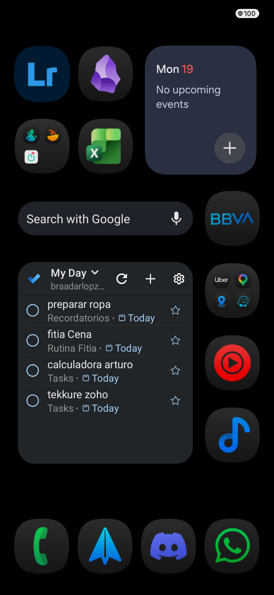

# Distribución del Inicio de Nemotron

**Captura de referencia:** 19 de octubre de 2026, Galaxy A54, página principal. La captura registra el estado visible después de restaurar el acomodo que el usuario indicó como correcto.

## Acomodo registrado

De arriba hacia abajo, según la captura:

- Primera fila: Lightroom a la izquierda, Obsidian al centro y widget de Calendario a la derecha.
- Segunda fila: carpeta de apps (incluye Samsung Health y otras apps personales) a la izquierda, Excel al centro; el widget de Calendario ocupa el espacio derecho de las dos primeras filas.
- Fila siguiente: barra «Search with Google» a la izquierda y BBVA a la derecha.
- Zona inferior central: widget «My Day» de Microsoft To Do a la izquierda; a la derecha, carpeta con Uber, Maps y otras apps, seguida por YT Music y el reproductor de música.
- Dock: Teléfono, Spark, Discord y WhatsApp, en ese orden de izquierda a derecha.
- Fondo negro.

La imagen es el registro visual del acomodo principal en ese momento; los elementos personales dentro de carpetas pueden cambiar por decisión del usuario. No se guardan datos de cuenta ni el contenido de tareas en este documento.

## Regla permanente para instalaciones

Instalar, actualizar, habilitar o deshabilitar una aplicación **no la añade al Inicio ni desplaza los iconos/widgets existentes**. Las apps nuevas permanecen fuera del escritorio hasta que el usuario las agregue explícitamente desde **Ajustes de Nemotron → Añadir aplicaciones**. Las páginas adicionales y cualquier reacomodo quedan bajo control del usuario.

El launcher filtra las altas automáticas de `AppItem` en el modelo y en los eventos de paquetes. La lista de adición manual incluye opciones explícitas para WhatsApp (`com.whatsapp`) y Samsung Health (`com.sec.android.app.shealth`), aunque Samsung no anuncie Health en la consulta habitual. Fijarlas requiere la confirmación del sistema. Este comportamiento no modifica ni borra los datos de las aplicaciones.

## Cambios al acomodo

Esta captura describe el estado de referencia del 19 de octubre de 2026. El usuario organiza el Inicio a su gusto; futuras instalaciones o compilaciones no deben restaurar esta distribución ni cambiarla automáticamente. Si el usuario cambia manualmente el escritorio y pide actualizar el registro, reemplazar la captura y corregir esta lista a partir de una nueva captura real.
